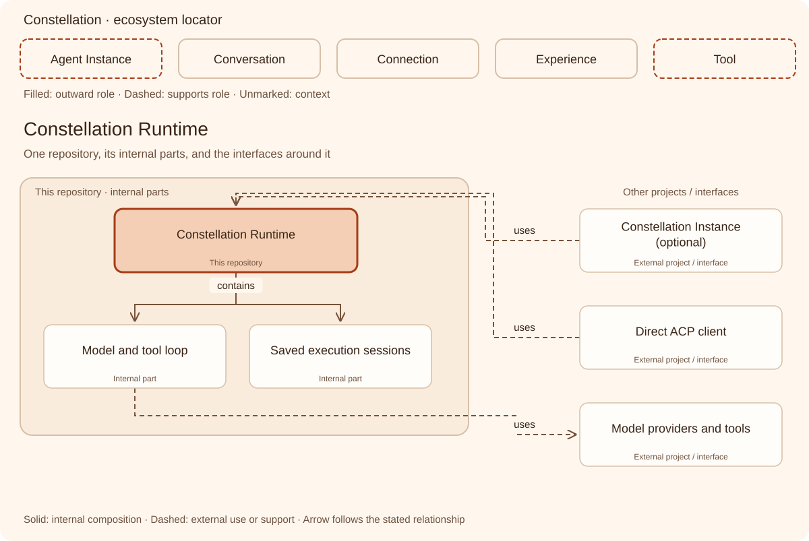

# Constellation Runtime

Constellation Runtime runs an agent's reasoning and tools and preserves its
execution sessions. It connects to clients through Agent Client Protocol (ACP)
and calls your configured model providers directly.

Use it as a standalone engine for an ACP client, or with
[Constellation Instance](https://github.com/microsoft/amplifier-constellation-instance)
for installed identity, remote access, and management. It is part of
[Amplifier Constellation](https://github.com/microsoft/amplifier-constellation).

## Get started

Download the archive for your computer from
[Releases](https://github.com/microsoft/amplifier-constellation-runtime/releases),
verify its checksum, and extract it. The packaged executable does not require
Rust, Python, Node, WSL, or another agent framework.

Create an agent home and choose a separate workspace:

```sh
./agent-runtime --home "$PWD/instance" init \
  --workspace "$PWD/workspace" --name "My agent" --model gpt-6.1-sol
```

For this OpenAI example, supply `OPENAI_API_KEY` privately in the process
environment and use a model available to your account. Configuration stores the
variable name, not its value. For another provider or a local model server, follow
[provider setup](docs/providers.md).

Configure your ACP client to launch:

```sh
/absolute/path/to/agent-runtime --home /absolute/path/to/instance acp
```

Use the configured workspace as the client's session working folder. Keep the
private agent home outside that workspace. On Windows, use `agent-runtime.exe`.

## Configure and inspect

- [Configuration](docs/configuration.md): inspect and change runtime settings.
- [Platform setup](docs/platforms.md): supported packages and optional integration requirements.
- [How Runtime works](docs/runtime-overview.md): the model/tool loop and saved state.
- [ACP capabilities](docs/acp-optional-capabilities.md): supported client controls.

`agent-runtime providers` lists provider presets. The `check`, `sessions`, and
`events SESSION_ID` commands support local inspection.

## Develop the engine

Start with the [contract map](contracts/README.md) and [validation guide](docs/validation.md).
The [vision](docs/VISION.md) explains the engine's intended contribution.


<!-- ecosystem-map:start -->
## Where this fits

A reasoning and tool-execution engine that an Instance or direct ACP client can use.

Supports: Agent Instance, Tool.



[Open the map](docs/ecosystem-map.svg) · [Product overview](https://microsoft.github.io/amplifier-constellation/projects/amplifier-constellation-runtime/) · [Map guide](https://github.com/microsoft/amplifier-constellation/blob/main/docs/ecosystem-maps.md)

<details>
<summary>The five shared building blocks</summary>

[](https://microsoft.github.io/amplifier-constellation/)

</details>

<!-- ecosystem-map:end -->

## Contributing

> [!NOTE]
> This project is not currently accepting external contributions, but we're actively working toward opening this up. We value community input and look forward to collaborating in the future. For now, feel free to fork and experiment!

Most contributions require you to agree to a
Contributor License Agreement (CLA) declaring that you have the right to, and actually do, grant us
the rights to use your contribution. For details, visit [Contributor License Agreements](https://cla.opensource.microsoft.com).

When you submit a pull request, a CLA bot will automatically determine whether you need to provide
a CLA and decorate the PR appropriately (e.g., status check, comment). Simply follow the instructions
provided by the bot. You will only need to do this once across all repos using our CLA.

This project has adopted the [Microsoft Open Source Code of Conduct](https://opensource.microsoft.com/codeofconduct/).
For more information see the [Code of Conduct FAQ](https://opensource.microsoft.com/codeofconduct/faq/) or
contact [opencode@microsoft.com](mailto:opencode@microsoft.com) with any additional questions or comments.

## Trademarks

This project may contain trademarks or logos for projects, products, or services. Authorized use of Microsoft
trademarks or logos is subject to and must follow
[Microsoft's Trademark & Brand Guidelines](https://www.microsoft.com/legal/intellectualproperty/trademarks/usage/general).
Use of Microsoft trademarks or logos in modified versions of this project must not cause confusion or imply Microsoft sponsorship.
Any use of third-party trademarks or logos are subject to those third-party's policies.
