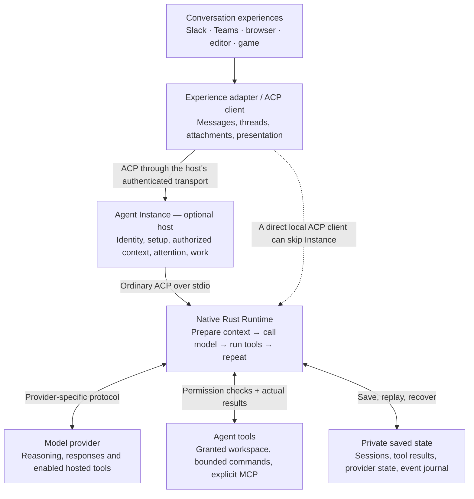

# How the Constellation runtime works

The runtime is an engine for an agent. It takes input, calls a model, uses
permitted tools, saves what happened and repeats until the interaction reaches a
terminal outcome. This walkthrough explains the implementation; the
[vision](VISION.md) describes intended value and the [contract map](../contracts/README.md)
locates the authoritative commitments.

## Connect the engine

A compatible client can use the engine directly. An optional Instance host can
supply installed identity, management and authorized context. The umbrella
[family agreement](https://github.com/microsoft/amplifier-constellation/blob/main/contracts/composition.md)
defines these service responsibilities and information ownership; this diagram
illustrates one composition rather than requiring the whole stack.

## Follow one interaction

1. **Record the input.** The ACP server checks the loaded session and obtains its
   execution lock. The engine loads saved history and records the new input.
2. **Prepare a model view.** Instructions, available tools and relevant history
   become the model's working context. [Context handling](context.md) defines how
   that view can be compacted while original evidence is preserved.
3. **Call the configured provider.** A provider adapter translates the request
   and response. [Provider contracts](providers.md) own protocol and account
   compatibility; optional media and hosted operations use the
   [native capability interface](native-capabilities.md).
4. **Use tools and observe results.** Validated calls pass through the applicable
   permission and execution boundary. The engine records intent and results;
   [Runtime boundaries](architecture.md) defines local and MCP behavior.
5. **Continue or settle.** Tool observations can lead to another model call. The
   interaction may end with a response, cancellation, refusal, error or a limit.
   The [ACP capability contract](acp-optional-capabilities.md) defines what the
   client can request and observe.

One interaction can contain several model calls and tools. The
[server](../src/server.rs), [engine](../src/engine.rs) and
[provider layer](../src/provider.rs) implement this path. A tool result, the end
of a prompt and the user's larger outcome remain distinct under the shared
[interaction agreement](https://github.com/microsoft/amplifier-constellation/blob/main/contracts/interaction.md).

## Continue the same work

Saved execution history and model working context are different records. The
[context contract](context.md) and [provider identity](provider-identity.md)
define preservation, retrieval and compatible continuation. Supported per-session
model or reasoning choices use [standard ACP configuration](acp-optional-capabilities.md#session-model-and-reasoning-choices),
including its explicit history restrictions.

New input can arrive while work is active when both ends support the negotiated
[steering interface](steering-design.md). Its receipts distinguish delivery and
incorporation rather than treating another message as implicit cancellation.
Plain ACP remains usable through the client's supported input boundaries.

Recovery uses retained execution and effect evidence. The concrete engine rules
live in [Runtime boundaries](architecture.md); a replay of saved conversation is
not a request to repeat actions. The optional Instance background-work service is
separate from an ACP connection's foreground execution.

## Improve a capability without rebuilding its neighbors

A change to context selection belongs with model working-context preparation; a
new provider belongs with provider translation; a workspace or MCP tool change
belongs with the execution boundary. Source membership, platform delivery and
ambient participation remain with their owners in the
[family map](https://github.com/microsoft/amplifier-constellation/blob/main/family.toml).

Optional [decision](decisions.md), [assessment](assessment.md), [watch](watches.md)
and [continuation](continuation.md) helpers have their own interfaces. They can be
used independently of the installed agent's engine and do not create a second
social admission policy.

Choose checks for the affected boundary using [validation](validation.md), then
exercise the combined path with its client or domain owner when their observable
behavior changes. Passing protocol fixtures and useful real-model behavior are
different claims; neither this overview nor an old release label substitutes for
checking the implementation at hand.
