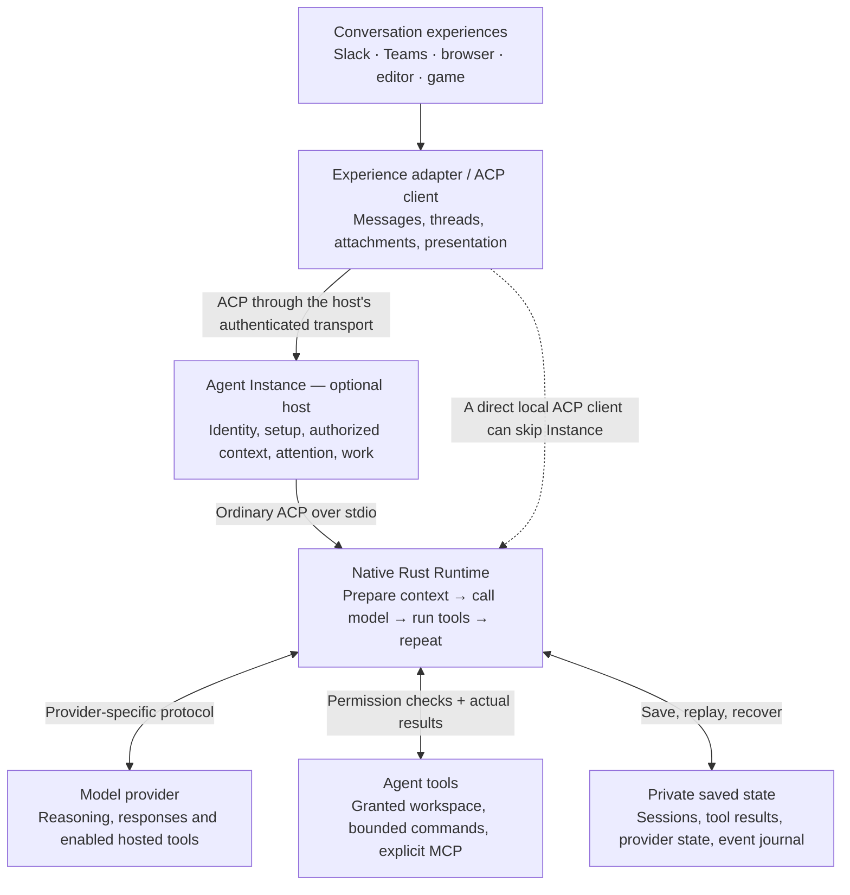

# How the Constellation runtime works

The runtime is the engine inside an agent. It takes an admitted request, calls a
model, runs permitted tools, saves what happened, and repeats until that turn is
finished. It is a standalone Rust implementation: its normal model/tool loop
does not require Codex or Claude Code.

This describes the **v0.10.0 implementation candidate**, reviewed on November 4, 2026.
It is a source overview, not a claim that every installation uses that version
or has enabled every optional capability. For detailed execution and security
boundaries, see [Runtime boundaries](architecture.md).

## One individual, several places to work

Each installed individual has its own configuration and private state. Several
conversations can reach that same individual while retaining separate session
histories. Sharing an identity does **not** make every conversation visible to
every other conversation. The optional Instance host connects authorized context
sources and profiles; their access rules still apply when the agent retrieves
information.

Repeat this arrangement for another agent, on the same machine or elsewhere.
There is no required central Constellation identity or provisioning service.
The [Observatory](https://github.com/microsoft/amplifier-constellation-observatory)
is an optional management client. Separate installation folders are also not,
by themselves, containers: deployment isolation and the runtime's tool
restrictions are separate boundaries.

## Who owns what?

| Component | Responsibility |
| --- | --- |
| Experience and its adapter | Own the conversation, participants, thread routing, platform authorization, attachment delivery and visible activity. Translate between the experience and ACP. |
| [Agent Instance](https://github.com/microsoft/amplifier-constellation-instance) | Own the installed individual's identity, configuration UI/API, profiles, authorized context connections, social attention and background work coordination. It can host this runtime or a different ACP engine. |
| This runtime | Own the model/tool loop, provider translations, session history, tool permissions, execution limits and ACP output. It can run directly without Instance. |
| Model provider | Generate responses and requested tool calls. Enabled provider-hosted tools execute in that provider's environment. |
| Tool or environment service | Perform the actual operation in its granted domain and return evidence. MCP connects these services; it does not grant access by itself. |

ACP is the common agent/client boundary. The Instance remote transport and its
management, context and attention features are optional extensions, not
requirements imposed on every ACP agent. Platform-specific behavior stays in
the corresponding adapter. See the
[family registry](https://github.com/microsoft/amplifier-constellation/blob/main/family.toml)
for the separate repositories.

## What happens during one turn?

1. **Accept and lock the session.** The ACP server verifies that the session is
   loaded and has no active turn, then the engine takes a cross-process lock.
   It loads saved history and records the new input before requesting a model.
2. **Build the model's working context.** Instructions, allowed tools and the
   relevant session history are fitted to a configured context budget. Older
   history can be compacted into a working view without deleting the originals.
3. **Call the selected provider.** A provider adapter translates the context into
   Responses, Anthropic Messages, Gemini or another supported protocol. Public
   output streams through ACP. Private reasoning/signatures remain private
   continuation data; they are not activity labels shown to users.
4. **Act on validated tool calls.** A complete, validated model response is
   required before execution. The engine saves the requested call, checks its
   permissions, executes it, then saves the real result. Local and MCP function
   calls are executed sequentially in this loop.
5. **Continue or finish.** Results become input to the next model call. The loop
   ends with a response, refusal, cancellation, error or an exhausted limit.
   Time, model-call, tool-call, output and context bounds are explicit.

One turn can contain many model calls and tools. Independent sessions can run
concurrently within configured process capacity; one session has one active
turn. The [server](../src/server.rs), [engine](../src/engine.rs) and
[provider layer](../src/provider.rs) implement this path.

## What survives reconnecting?

The private SQLite store uses one persistent connection shared by runtime callers;
short storage operations finish before any model or tool wait. It retains sessions,
original messages, tool calls and
results, turn states, event history, context checkpoints and provider bindings.
Provider-specific continuation data is preserved alongside public records.
An exercised session stays bound to its provider, endpoint and model; changing
those requires a new session rather than silently translating private state.

If execution stops after an action starts, its effect can be uncertain. Recovery
records that uncertainty and does **not** automatically repeat the action.
Replaying a conversation displays saved results; it does not rerun tools.
An ACP connection owns its active foreground work, so disconnecting cancels it.
Instance can separately own explicitly authorized background work across a UI
disconnect. Saved history alone is not a background scheduler.

See [storage](../src/store.rs), [history access](../src/history.rs),
[context preparation](../src/context.rs) and the [context contract](context.md).

## Tools, models and visible activity

The common loop supports workspace files, bounded commands and explicitly
connected MCP tools. Workspace file access uses directory capabilities.
Commands use platform confinement with no unrestricted fallback: bubblewrap on
Linux, Seatbelt on macOS, and AppContainer/Job Objects on Windows. Network access
is a separate setting; Linux can inherit the enclosing installation's network.
The model's credential and the host home are not passed to workspace commands.
Owner-authorized local MCP programs are a separate, stronger trust grant.

Read-only, ask-before-changes and workspace modes govern local execution.
External mutations still require the configured authorization path. A persona,
model answer, or decision score cannot grant permission. An experience may
answer permission requests according to its own configured approval policy.

Model adapters preserve each protocol's tool-result ordering and continuation
state. Optional native capabilities include media, generated files, searches,
hosted code execution and structured output, with support dependent on the
provider, model, account and explicit configuration. Responses computer control
uses a separately configured MCP environment. These are not promises that every
model supports every tool. See [providers](providers.md),
[native capabilities](native-capabilities.md), [tools](../src/tools.rs) and
[MCP connections](../src/mcp.rs).

The runtime emits ACP text/media and tool lifecycle events with IDs, titles,
kinds and states. Instance preserves the boundary; the adapter renders activity
in the correct conversation. The shared
[activity contract](https://github.com/microsoft/amplifier-constellation/blob/main/contracts/adapter-activity.v1-candidate.md)
calls for “Thinking…” while waiting and useful present-tense tool labels during
execution. The runtime also records model/tool events for inspection. An
activity indicator reports observed work, not proof that the task succeeded.

## Decisions, watches and attention are different jobs

The runtime includes optional reusable helpers for typed decisions,
evidence-based assessments, task-condition watches and bounded continuation
advice. A watch notices a relevant change within an existing responsibility;
its host supplies the authorized observations and controls any wake-up. These
helpers do not create work, extend deadlines, approve tools or establish that a
reported result is true.

**Social attention belongs to Instance:** deciding whether this individual
should join an ambient conversation. Once admitted, the runtime receives an
ordinary ACP prompt, without running a second social classifier. This also lets
Instance apply the same policy to third-party ACP engines. See
[decisions](decisions.md), [assessments](assessment.md), [watches](watches.md),
[continuation](continuation.md) and the
[Instance attention contract](https://github.com/microsoft/amplifier-constellation/blob/main/contracts/attention.v1-candidate.md).

## Current boundaries and next design work

A second ordinary prompt for an active session is rejected, but a client that
negotiates `_session/steering` can add ordered input to that logical turn. A
durable inbox records receipt, provider submission, incorporation and uncertain
outcomes. OpenAI generation uses one Responses WebSocket per logical turn and
GPT-6 native steering. Other providers receive the ordered inputs at the next
legal model-call boundary, after actual tool results. Neither path cancels
ongoing work merely because another message arrives.

The same original call, tool and elapsed-time limits apply throughout. Lost
acknowledgments and incomplete successor history require explicit reconciliation;
no tool effect or unknown input is blindly replayed. See
[Steering and repeated input](steering-design.md) for wire, recovery and budget
contracts. Ordinary ACP hosts continue using normal prompt/load/list methods;
steering is an optional extension.

The runtime also does not provide global memory, automatic reconciliation of
commitments, built-in multi-agent delegation, a fleet manager or a mobile UI.
Those responsibilities must be supplied deliberately by the surrounding system.
The source and protocol checks listed in [validation](validation.md) describe
what has been tested; this documentation change does not add live deployment or
model-quality validation.
